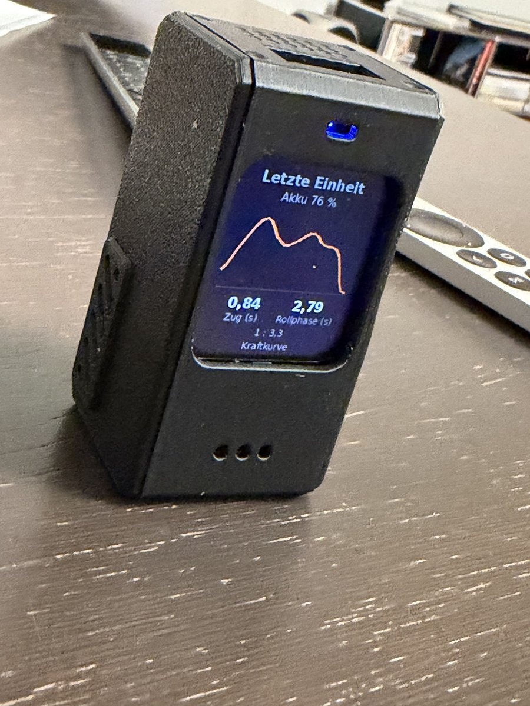
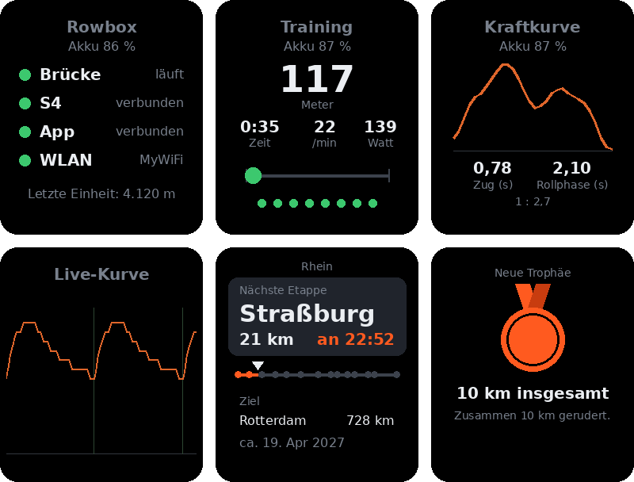
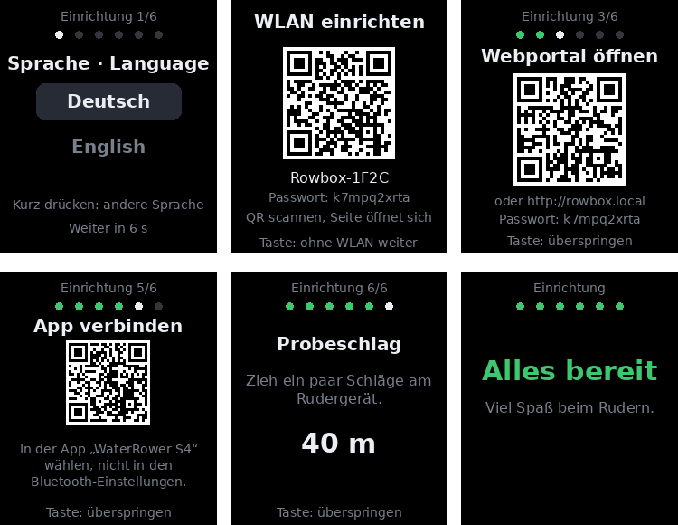
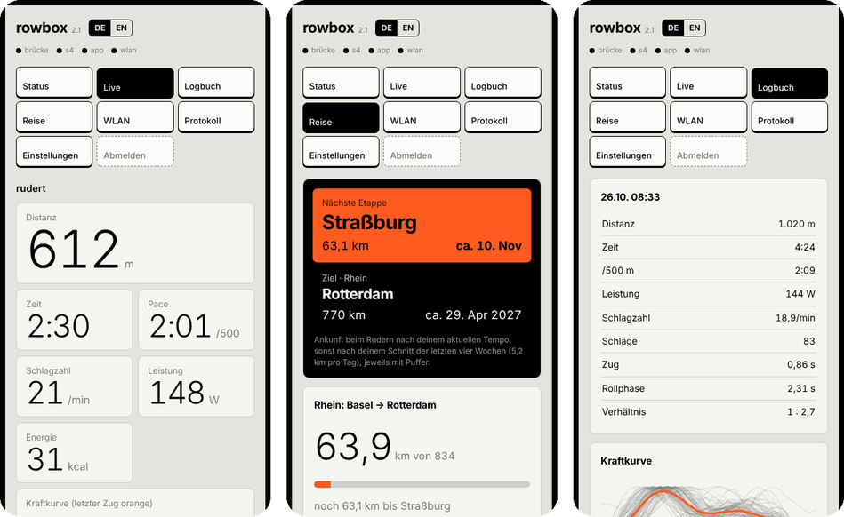
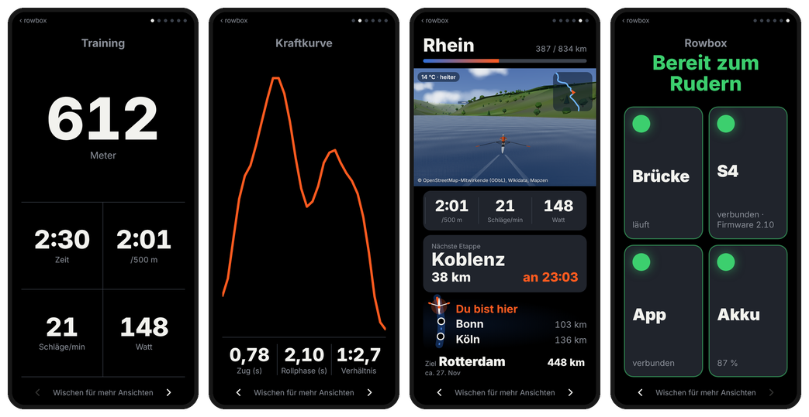
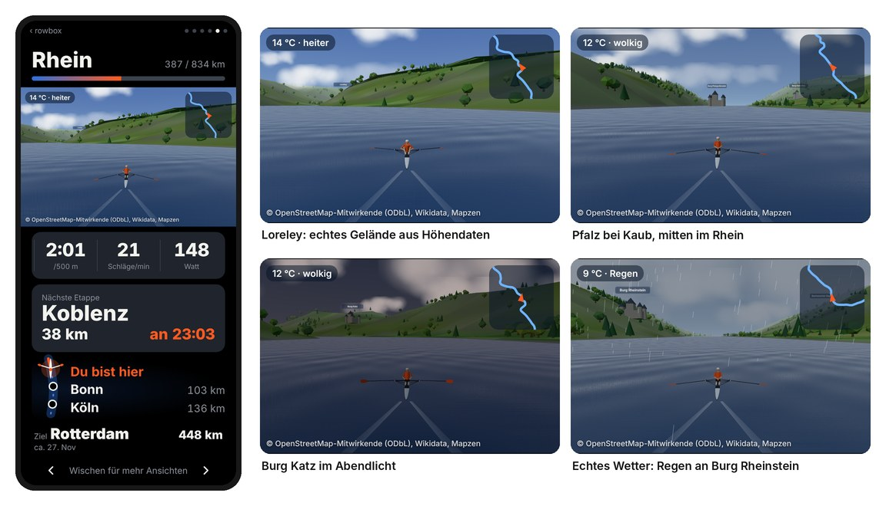
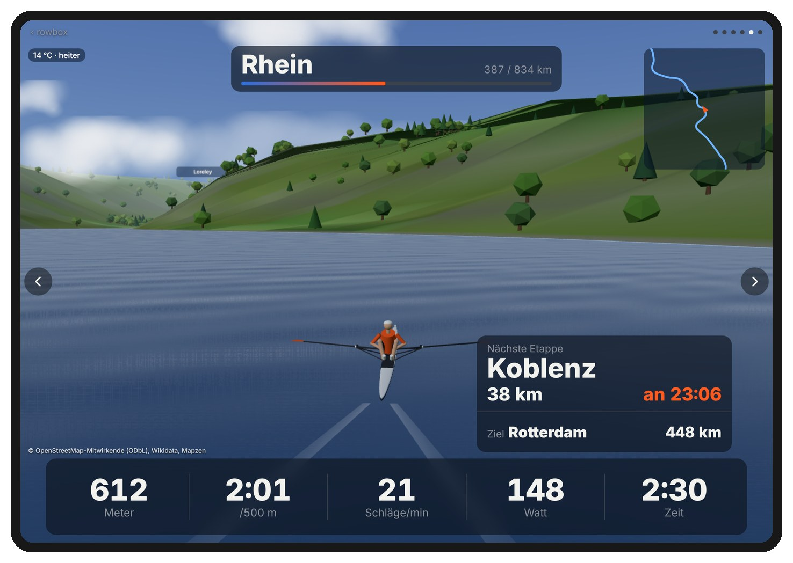
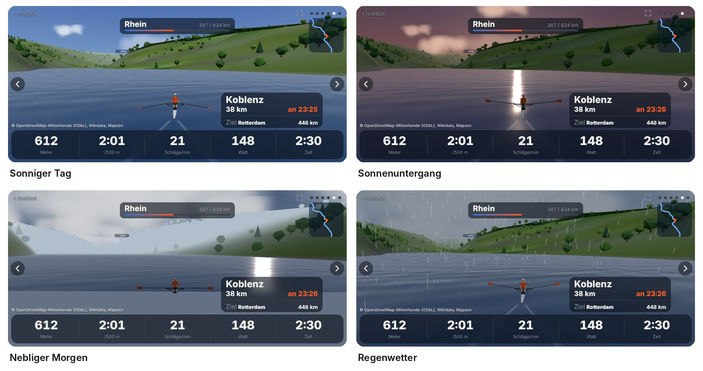
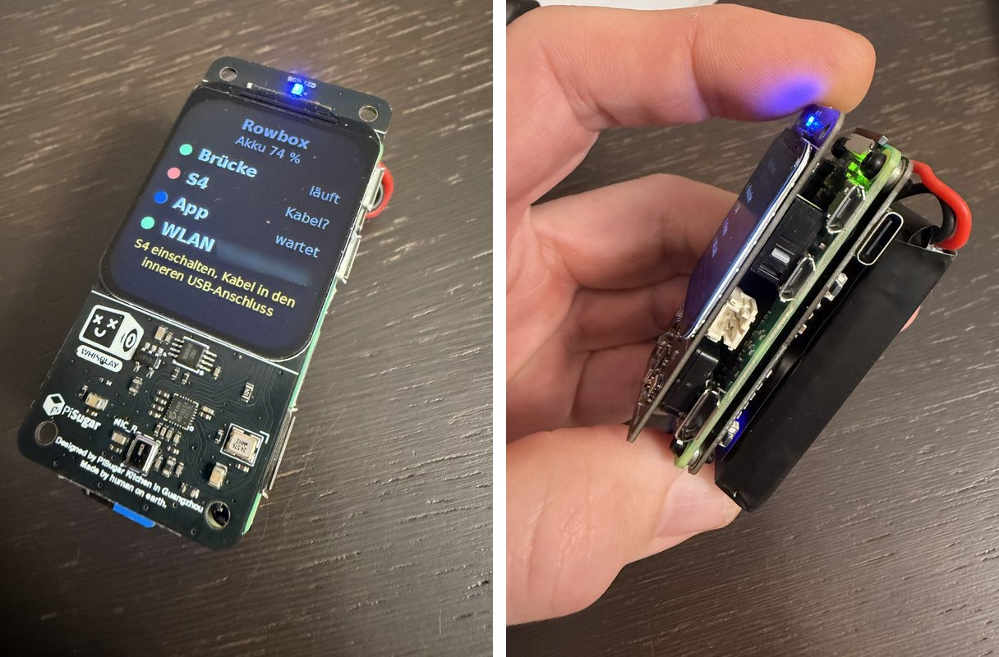

# Rowbox

**Bluetooth für den WaterRower S4. Eine kleine Open-Source-Box mit Display, Kraftkurve, Logbuch
und einer 3D-Flussfahrt auf dem Handy.**

[](LICENSE)


[English README](README.md)

Der Leistungsmonitor S4 des WaterRower hat einen USB-Anschluss, aber kein Bluetooth. Die Rowbox
steckt an diesem Anschluss, liest den Monitor aus und meldet sich als normales
**Bluetooth-FTMS-Rudergerät**, das Fitness-Apps verstehen. So landen deine Einheiten in Apps wie
*Rowing Workout* auf der Apple Watch und von dort in Apple Health. Dazu zeigt sie dein Training auf
ihrem eigenen Display oder auf dem Handy, zeichnet jeden Zug auf und lässt dich echte Flüsse
rudern.

<p align="center">
  
  
</p>
<p align="center"><sub>Die Box im Gehäuse und sechs ihrer Ansichten: Status, Training mit Taktgeber, Kraftkurve, Live-Kurve vom Paddelrad, Reise und eine Trophäe.</sub></p>

## Auf einen Blick

| | |
|---|---|
| **Verbindet** | WaterRower S4 (USB) → Bluetooth-FTMS-Rudergerät für iPhone, Apple Watch, Android, Meta Quest und mehr |
| **Zeigt** | Live-Werte, Kraftkurve, Taktgeber und Reise auf dem Display der Box, im Browser und im Vollbild auf Handy oder Tablet |
| **Zeichnet auf** | Jede Einheit im Logbuch mit Sekundenwerten, Export als FIT, TCX, CSV oder JSON für Strava, Garmin Connect, Intervals.icu |
| **Motiviert** | Reisen auf echten Strecken, ein 3D-Rhein von Basel bis Rotterdam mit echtem Gelände, Landmarken und Wetter, entspannte Trophäen |
| **Läuft** | Auf einem Raspberry Pi Zero 2 W, mit oder ohne Akku und Display, auf Wunsch ganz ohne Internet |
| **Kostet** | Etwa 35–100 € für die Teile, je nach [Variante](#varianten) |

## Inhalt

- [Funktionen](#funktionen)
- [Den Rhein in 3D rudern](#den-rhein-in-3d-rudern)
- [Teile](#teile)
- [Installation](#installation)
- [Benutzung](#benutzung)
- [Kompatibilität](#kompatibilität)
- [Fehlerbehebung](#fehlerbehebung)
- [Datenschutz](#datenschutz)
- [Entwicklung](#entwicklung)
- [Lizenz und Quellen](#lizenz-und-quellen)

## Funktionen

### Bluetooth-Brücke

- **Normales FTMS-Rudergerät:** Distanz, Schlagzahl, Schläge, Pace, Leistung, Kalorien und Zeit.
  Apps sehen ein Rudergerät namens **"WaterRower S4"**.
- **In beide Richtungen:** Ein Zurücksetzen in der App setzt auch den S4 zurück. Den Puls gibt die
  Box weiter, wenn der S4 einen Pulsempfänger hat.
- **Sauber gemeldet:** Die Box nennt Hersteller, Modell und Version (Device Information Service),
  was manche Apps vor dem Verbinden verlangen. Sie liest die Firmware des S4 aus und zeigt sie im
  Portal.

### An der Box

- **Display:** Status, Training live, Zusammenfassung nach der Einheit, Verlauf der letzten
  Einheiten, Taktgeber, Live-Kurve und Reise. Geht nach einer Weile aus, die Taste weckt es. Welche
  Ansichten die Taste durchblättert, legst du selbst fest.
- **Einrichtungsassistent:** Beim ersten Start führt das Display durch Sprache, WLAN, Webportal
  (Anmeldung per QR-Code), S4 und App verbinden und einen Testzug. Jeder Schritt hakt sich selbst ab.
- **Tasten:** Kurz auf die Display-Taste blättert die Ansichten, 3 Sekunden halten öffnet den
  Hotspot. Die PiSugar-Taste zeigt den Akkustand, schaltet die Box ein und fährt sie sauber herunter
  ([Details](#tasten)).
- **Pausen-Countdown, Töne, Uhr ohne WLAN:** In einer kurzen Pause zeigt das Display, wann die
  Einheit automatisch endet; kurze Töne, wenn S4 oder App sich verbinden; die Echtzeituhr des
  PiSugar hält die Zeiten im Logbuch auch ohne Internet richtig.

<p align="center"></p>

### Webportal

Unter `http://<hostname>.local`, mit Passwort geschützt: Status, WLAN-Netze, Logbuch, Protokolle
und alle Einstellungen. Die **Live-Ansicht** zeigt große Zahlen für Handy oder Tablet am Rudergerät,
die Kraftkurve jedes Zugs sowie Zug- und Rollzeit.

<p align="center"></p>
<p align="center"><sub>Webportal auf dem Handy: Live-Ansicht, Reise und die Auswertung einer Einheit.</sub></p>

### Handy und Tablet als Display

`http://<hostname>.local/anzeige` zeigt die Ansichten der Box im Vollbild auf dem Handy: Training,
Kraftkurve, Taktgeber, Live-Kurve, Reise und Status, gewechselt durch Wischen. Bei der
Ultralight-Variante ist das dein Display.

- **Hochkant und quer:** Jede Ansicht hat für beides ein eigenes Layout. Quer wird die Reise zum
  Cockpit mit dem 3D-Fluss über den ganzen Bildschirm.
- **Bleibt an:** Der Bildschirm sperrt sich nicht, solange die Anzeige offen ist.
- **Wie eine App:** Vollbild-Knopf auf iPad und Android; auf dem iPhone die Seite zum Home-Bildschirm
  hinzufügen, dann startet sie ohne Browserleisten.

<p align="center"></p>

### Kraftkurve, Taktgeber und Live-Kurve

- **Kraftkurve:** Der S4 meldet alle 25 ms die Impulse seines Sensors am Paddelrad. Daraus berechnet
  die Box die Form jedes Zugs, ganz ohne zusätzlichen Sensor. Live, auf dem Display und pro Einheit
  im Logbuch (Durchschnitt, jeder einzelne Zug, Anfang und Ende im Vergleich).
- **Taktgeber:** Ein Punkt läuft wie der Rollsitz, schnell im Zug, langsam beim Vorrollen, in deinem
  eigenen Rhythmus oder in fester Schlagzahl. Punkte darunter zeigen, ob jeder Schlag im Takt war.
- **Live-Kurve:** die Geschwindigkeit des Paddelrads der letzten sechs Sekunden.

### Logbuch und Export

Jede Einheit wird auf der Box gespeichert: Distanz, Zeit, Pace, mittlere und höchste Leistung,
Schlagzahl, Puls und die Kraftkurve. Das Logbuch gibt es als CSV oder JSON, jede Einheit als
**FIT- oder TCX-Datei** mit Sekundenwerten für Strava, Garmin Connect, Intervals.icu und andere.

### Reisen und Trophäen

Jeder geruderte Meter bringt ein Boot auf einer echten Strecke voran: Rhein, Themse, Seine, Po,
Nil, Jangtse, Mississippi, Amazonas, Murray, Ärmelkanal, der Onyx in der Antarktis oder über den
Atlantik. Dargestellt wie ein Navi mit nächster Etappe, Ziel und entspannt geschätzter Ankunft.
Trophäen, etwa für die ersten 10 km, erscheinen nach der Einheit. Keine Serien, keine Fristen,
nichts geht verloren; abschaltbar. Auf dem Rhein ist die Reise eine [3D-Szene](#den-rhein-in-3d-rudern).

### Verbindungen

- **Hotspot als Rückfall:** Findet die Box kein bekanntes WLAN, öffnet sie ihren eigenen Hotspot und
  zeigt einen QR-Code; die Einrichtungsseite öffnet sich von selbst. Eine **Hotspot-Karte** zum
  Ausdrucken hält Name, Passwort und QR-Code bereit.
- **MQTT (optional):** schickt die Werte an einen MQTT-Server; Home Assistant übernimmt sie
  automatisch.
- **Deutsch und Englisch:** Display, Webportal und Setup-Skript, jederzeit umschaltbar.

## Den Rhein in 3D rudern

Auf dem Handy zeigt die Reise-Ansicht einen Einer auf dem Fluss, und der Ruderer darin bewegt sich
mit **deinen** Schlägen: Jeder Durchzug beginnt mit deinem echten Zuganfang, erst die Beine, dann
der Oberkörper, und das Boot schiebt nach der Form deiner Kraftkurve. Hörst du auf, wartet er am
Zuganfang.

<p align="center"></p>

- **Der echte Rhein, Basel bis Rotterdam (834 km):** der Flussverlauf aus OpenStreetMap, echtes
  Gelände aus Höhendaten (im Mittelrheintal steigen die Hänge 150–200 m an), 74 Brücken und 242
  Landmarken mit Namen, von Burg Rheinstein und der Loreley bis zu den Windmühlen von Kinderdijk.
  Eine kleine Karte zeigt, wo du bist.
- **Echtes Licht und Wetter:** Die Sonne steht dort, wo sie an diesem Ort und zu dieser Zeit
  wirklich steht. Ist die Box online, kommt das aktuelle Wetter an deiner virtuellen Position dazu:
  Wolken, Regen, Schnee, Nebel und Wind auf dem Wasser. Oder du wählst eine feste Stimmung:
  sonniger Tag, Sonnenuntergang, nebliger Morgen oder Regenwetter.
- **Live-Werte auf dem Fluss:** Pace, Schlagzahl und Watt in einer Karte unter der Szene, dazu
  nächste Etappe und Ziel.
- **Cockpit im Querformat:** Auf dem Tablet oder dem quer gedrehten Handy füllt der Fluss den
  Bildschirm, Strecke, nächste Etappe und fünf Live-Werte liegen auf Glaskarten darüber.
- **Nach deinem Geschmack:** Du wählst, was die Ansicht zeigt, und die Farben von Boot, Blättern und
  Shirt des Ruderers (Einstellungen → Reise).
- **Schont die Box:** three.js läuft im Browser des Handys und passt die Auflösung dem Gerät an; der
  Pi liefert nur die Dateien. Die Strecke liegt auf der Box, beim Rudern ist kein Kartendienst
  nötig.

<p align="center"></p>
<p align="center"><sub>Quer auf dem Tablet: die Reise als Cockpit.</sub></p>

<p align="center"></p>
<p align="center"><sub>Feste Stimmungen, wenn dir ein bestimmtes Licht lieber ist als das echte.</sub></p>

Andere Strecken zeigen vorerst einen erzeugten Fluss; `tools/build_route.py` macht aus
OpenStreetMap-Daten eine Streckendatei (siehe [CONTRIBUTING](CONTRIBUTING.md), auf Englisch).

## Teile

### Varianten

| | Voll | Light | Ultralight |
|---|---|---|---|
| Raspberry Pi Zero 2 W | ✓ | ✓ | ✓ |
| PiSugar Whisplay (Display) | ✓ | ✓ | – |
| PiSugar 3 (Akku) | ✓ | – (USB-Powerbank oder Netzteil) | – (USB-Powerbank oder Netzteil) |
| Bluetooth FTMS, Kraftkurve, Logbuch, FIT/TCX, Reisen, Webportal, MQTT | ✓ | ✓ | ✓ |
| Handy und Tablet als Display, 3D-Fluss | ✓ | ✓ | ✓ |
| Display an der Box, Töne, Einrichtungsassistent | ✓ | ✓ | – |
| Akkuanzeige, Ausschalttaste, Uhrzeit ohne WLAN | ✓ | – | – |
| Teilekosten (ca.) | 100 € | 70 € | 35 € |
| Installation | `setup.sh` | `setup.sh --no-pisugar` | `setup.sh --no-display --no-pisugar` |

Light und Ultralight sind neu und noch nicht an einer echten Box getestet; Rückmeldungen sind
willkommen. Ohne PiSugar die Box vor dem Ausstecken im Webportal ausschalten.

### Teileliste

| Teil | Hinweis |
|---|---|
| Raspberry Pi Zero 2 W | mit eingelöteter Stiftleiste |
| [PiSugar 3](https://pisugar.com) | Akku mit 1.200 mAh, sitzt unter dem Pi ([Software](https://github.com/PiSugar/pisugar-power-manager-rs)). Optional: Eine USB-Powerbank geht auch, dann fehlen nur Akkuanzeige, Uhr und Ausschalttaste |
| [PiSugar Whisplay HAT](https://pisugar.com) | 1,69"-LCD, Lautsprecher, Mikrofone, Taste, RGB-LED ([Treiber](https://github.com/PiSugar/whisplay)) |
| microSD-Karte | ab 8 GB |
| USB-Kabel | Mini-USB (S4) auf Micro-USB (Pi), oder Mini-USB-Kabel plus Micro-USB-OTG-Adapter |
| Gehäuse | zum Drucken: [PiSugar suit-cases / pisugar3-whisplay-chatbot-fdm](https://github.com/PiSugar/suit-cases/tree/main/pisugar3-whisplay-chatbot-fdm) |

Der S4 kommt an den **inneren** Micro-USB-Anschluss des Zero (beschriftet mit USB), nicht an den
Stromanschluss.

<p align="center"></p>
<p align="center"><sub>Ohne Gehäuse: oben das Whisplay-Display, darunter der Pi Zero 2 W und der PiSugar 3 mit Akku.</sub></p>

## Installation

1. Mit dem Raspberry Pi Imager **Raspberry Pi OS Lite (64-bit)** schreiben. In den Einstellungen
   Hostname (zum Beispiel `rowbox`), Benutzer, Passwort und WLAN festlegen und SSH einschalten.
2. Starten, ein paar Minuten warten (der erste Start dauert auf dem Zero lange), dann anmelden:
   `ssh <benutzer>@<hostname>.local`
3. Installieren:
   ```sh
   sudo apt install -y git
   git clone https://github.com/intecsys/rowbox.git
   sudo bash rowbox/setup.sh
   sudo reboot
   ```
   Das richtet Brücke, Anzeige und Portal als Dienste ein, dazu die PiSugar-Werkzeuge, den
   Whisplay-Treiber (baut ein Kernelmodul, dauert eine Weile) und den WLAN-Fix für gemischte
   WPA2/WPA3-Router.
4. Nach dem Neustart startet der Einrichtungsassistent auf dem Display. Das Passwort fürs Portal
   steht außerdem unter **Info**.

`setup.sh` spricht je nach Systemsprache Deutsch oder Englisch; festlegen lässt es sich mit
`--lang de` oder `--lang en`.

**Aktualisieren** später mit:
```sh
cd ~/rowbox && git pull && sudo bash setup.sh && sudo reboot
```

### Light und Ultralight

Schritt 3 mit einer oder zwei Optionen (siehe [Varianten](#varianten)):

```sh
sudo bash rowbox/setup.sh --no-pisugar                # Light: Display, kein Akku
sudo bash rowbox/setup.sh --no-display --no-pisugar   # Ultralight: kein Display, kein Akku
```

Ultralight hat keinen Einrichtungsassistenten: `setup.sh` zeigt am Ende das Passwort fürs Portal,
den Namen des Hotspots und einen QR-Code (das Passwort später nachsehen mit
`sudo grep password /etc/rowbox.json`). Danach in der App mit **"WaterRower S4"** verbinden,
`http://<hostname>.local/anzeige` auf dem Handy öffnen und das Handy ans Rudergerät stellen.

**Neues WLAN ohne Display:** Findet die Box kein bekanntes WLAN, öffnet sie nach etwa einer Minute
(zwei Minuten nach dem Einschalten) ihren eigenen Hotspot. Mit Name und Passwort aus `setup.sh` oder
über den QR-Code verbinden, die Einrichtungsseite öffnet sich von selbst (sonst `http://10.42.0.1`),
und unter **WLAN** das Netz wählen. Tipp: die **Hotspot-Karte** ausdrucken (Portal → Einstellungen →
Hotspot) und auf die Box kleben.

## Benutzung

1. S4 einschalten und mit der Box verbinden.
2. In der App mit dem Rudergerät **"WaterRower S4"** verbinden. Auf dem iPhone geschieht das in der
   App, nicht in den Bluetooth-Einstellungen von iOS.
3. Rudern. Das Display springt von selbst auf die Trainingsansicht.

Getestet mit *Rowing Workout* auf iPhone und Apple Watch: Die Einheit erscheint in Apple Fitness als
"Rudern indoor", mit der Distanz vom S4 und dem Puls von der Uhr.

### Tasten

| Taste | Kurz drücken | Halten |
|---|---|---|
| Display-Taste | nächste Ansicht | 3 Sekunden: Hotspot öffnen oder schließen |
| PiSugar 3, unten (neben den LEDs) | Akkustand zeigen; kurz drücken und dann halten schaltet die Box ein | im Betrieb: sauber herunterfahren; kurz plus halten trennt den Strom (nur, wenn die Box hängt) |
| PiSugar 3, oben | Statusansicht | Sprache umschalten |

## Kompatibilität

### Apps

Die Rowbox meldet sich als normales Bluetooth-FTMS-Rudergerät namens **"WaterRower S4"**. „Sollte
gehen“ heißt: Der Hersteller nennt FTMS-Rudergeräte allgemein als unterstützt, mit der Rowbox
getestet ist es noch nicht. Rückmeldungen sind willkommen.

| App | Plattform | Mit Rowbox | Hinweise |
|---|---|---|---|
| [Rowing Workout](https://apps.apple.com/app/id6470894043) | iPhone, Apple Watch | **getestet** | Kostenlos (Pro optional); speichert in Apple Health/Fitness |
| [Kinomap](https://support.kinomap.com/hc/en-us/articles/360015335632-What-is-the-FTMS-protocol) | iOS, Android | sollte gehen | Abo; unterstützt FTMS-Geräte allgemein |
| [EXR](https://exrgame.com/support/compatible-machines) | iOS | sollte gehen | Abo; „alle FTMS-Rudergeräte kompatibel“, Genauigkeit ohne Gewähr |
| [Holofit](https://www.holodia.com/?p=5719) | Meta Quest | sollte gehen | VR, Abo; FTMS-Rudergeräte verbinden sich direkt |
| [Peloton App](https://www.pelobuddy.com/third-party-rowers-ftms/) | iOS | sollte gehen | App+ / All-Access; laut Community-Berichten |
| [Track My Indoor Workout](https://trackmyindoorworkout.github.io) | Android | sollte gehen | Kostenlos, Open Source; Upload zu Strava/TrainingPeaks, eigener Pulsgurt |
| [FTMS Rowing](https://abscreations.gumroad.com/l/FTMSRowing) | Garmin (Connect IQ) | sollte gehen | Datenfeld für „Rudern Indoor“; nach 10 Minuten kostenpflichtig |
| ArduRower-IQ | Garmin (Connect IQ) | unklar | Kostenlos; soll mit FTMS-Rudergeräten laufen |
| MyHomeFit, WaterRower Connect, Amazfit-Uhren | verschieden | unklar | Noch keine klare Aussage zu allgemeinen FTMS-Rudergeräten |

Nicht kompatibel: ErgData, Aviron, Ergatta, Hydrow (nur Concept2 oder eigene Hardware), Zwift
(kein Rudern), Apple GymKit (nur zertifizierte Studiogeräte), Strava und Garmin-Uhren direkt (keine
Bluetooth-Rudergeräte; Garmin koppelt Rudergeräte nur über ANT+). Für Strava und Garmin Connect den
FIT-Export nutzen oder eine App, die hochlädt.

### Rudergeräte

| Monitor | Mit Rowbox | Hinweise |
|---|---|---|
| S4 mit Mini-USB-Anschluss („S4 version 2“) | **ja** | Serienmäßig bei Original/Natural/Oak/Club/Shadow/M1/S1 und anderen; auch als Nachrüstung für Hybrid/Pure |
| S4 mit RS-232-Anschluss („S4 version 1“) | unklar | Seriell statt USB; vielleicht mit USB-Seriell-Adapter, ungetestet |
| S4 BLE (Bluetooth eingebaut) | unklar | Verbindet sich schon selbst mit Apps; unklar, ob es noch den USB-Datenanschluss hat |
| S4 + ComModule | entweder/oder | Das ComModule nutzt denselben USB-Anschluss; nur eins von beiden |
| A1 / A1 BLE, Performance Ergometer | nein / unklar | Anderer Monitor, nicht das S4-Protokoll |
| Series I–III, S3 | nein | Außer nach Umrüstung auf S4 |

**Welchen S4 hast du?** Einschalten, neunmal **advanced** drücken, dann **OK**: Unten rechts steht die
Firmware. USB-Monitore laufen mit 2.01, 2.03 oder der aktuellen 2.1; ältere aktualisiert WaterRower
auf Anfrage. Die Rowbox zeigt die Version auch im Portal. Der Mini-USB-Anschluss sitzt hinten am S4;
ist die Rowbox verbunden, zeigt der S4 „PC“. Mehr dazu: [docs/s4-notes.md](docs/s4-notes.md)
(Englisch).

## Fehlerbehebung

- **"Killed" bei der Installation:** Der Zero hat nur 512 MB Arbeitsspeicher, apt läuft manchmal
  über. `setup.sh` einfach noch einmal starten, es macht dort weiter.
- **PiSugar-Download langsam:** Der Paketserver von PiSugar ist aus Europa teils langsam. Abwarten.
- **WLAN an Routern im gemischten Modus WPA2/WPA3:** Mit dem aktuellen Raspberry Pi OS verbindet
  sich der Zero 2 W nicht damit ([raspberrypi/linux#7634](https://github.com/raspberrypi/linux/issues/7634)).
  `setup.sh` behebt das, indem es `brcmfmac.feature_disable=0x2282000` in
  `/boot/firmware/cmdline.txt` einträgt; zu tun ist nichts. Getestet mit Kernel 6.18.
- **Die Box heißt anders:** Nimm den Hostnamen, den du im Raspberry Pi Imager vergeben hast, zum
  Beispiel `http://rower.local`.
- **LED und Display werden absichtlich nicht gedimmt:** Die Whisplay-Bibliothek dimmt per Software,
  dann flackern beide, sobald der Prozessor rechnet.
- **Der S4 bleibt an, solange die Box angeschlossen ist,** und leert dabei seine Batterien. Nach dem
  Rudern die Box ausschalten (PiSugar-Taste halten) oder abziehen.

## Datenschutz

Die Rowbox braucht kein Konto und keine Cloud. Deine Einheiten bleiben auf der Box, bis du sie
exportierst. Die einzige Anfrage ins Internet ist freiwillig: Im Modus „echtes Wetter“ holt die Box
etwa alle 15 Minuten das aktuelle Wetter bei [Open-Meteo](https://open-meteo.com), und zwar für
deine *virtuelle* Position auf der Strecke und nur, wenn sie online ist. Abschalten lässt sich das
unter Einstellungen → Reise mit einer festen Stimmung oder „Echte Uhrzeit, ohne Wetter“.

## Entwicklung

### Aufbau

```
S4-Monitor --USB seriell--> rowbridge.py --Bluetooth FTMS--> App
                                |
                                +--> /run/rowbridge/state.json --> rowdisplay.py (Whisplay)
                                +--> /var/lib/rowbridge/sessions.jsonl (Logbuch)
rowportal.py: Webportal auf Port 80, Handy-Anzeige, Hotspot als Rückfall, Einstellungen in /etc/rowbox.json
static/river3d.js: 3D-Fluss (three.js), läuft im Browser des Handys
```

Das USB-Protokoll des S4 hat WaterRower dokumentiert ("Water Rower S4 S5 USB Protocol Iss 1 04"),
dazu mehrere Open-Source-Projekte. Mehr zum S4: [docs/s4-notes.md](docs/s4-notes.md) (Englisch).

### Testen ohne Rudergerät

```sh
sudo systemctl stop rowbridge
python3 ~/s4sim.py &
sudo python3 ~/rowbridge.py ~/s4sim
```
Der Simulator rudert 60 Sekunden, pausiert 20 und beginnt von vorn. Mit `Ctrl+C`, `kill %1` und
`sudo systemctl start rowbridge` geht es zurück in den Normalbetrieb.

### Mitmachen

Fehlermeldungen, Ideen und Pull Requests sind willkommen, siehe [CONTRIBUTING.md](CONTRIBUTING.md)
(Englisch). Dort steht auch, wie eine Reise und ein echter Flussverlauf dazukommen.

### Verwandte Projekte

- [PiRowFlo](https://github.com/inonoob/pirowflo): S4/SmartRow nach BLE und ANT+ auf dem Raspberry Pi
- [OpenRowingMonitor](https://github.com/JaapvanEkris/openrowingmonitor): Rudermonitor mit eigenem Sensor am Schwungrad
- [ESP Rowing Monitor](https://github.com/Abasz/ESPRowingMonitor): dasselbe auf einem ESP32

## Lizenz und Quellen

Die Rowbox steht unter der **GPL-3.0-or-later**, siehe [LICENSE](LICENSE). Du darfst sie nutzen,
ändern und weitergeben, auch kommerziell, solange du den vollständigen Quellcode deiner Version
unter derselben Lizenz veröffentlichst.

| Teil | Quelle und Lizenz |
|---|---|
| `static/three.module.min.js` | [three.js](https://threejs.org), MIT ([static/LICENSE.three.txt](static/LICENSE.three.txt)) |
| Flussverläufe in `static/routes/` | aus [OpenStreetMap](https://www.openstreetmap.org/copyright), © OpenStreetMap-Mitwirkende, [ODbL 1.0](https://opendatacommons.org/licenses/odbl/) |
| Brückennamen | [Wikidata](https://www.wikidata.org), CC0 |
| Geländehöhen | [AWS Terrain Tiles](https://registry.opendata.aws/terrain-tiles/) (Mapzen/Tilezen), offene Daten mit Quellenangabe |
| Wetter | [Open-Meteo](https://open-meteo.com), frei für nicht-kommerzielle Nutzung |

Ohne Gewährleistung. Nachbau und Nutzung auf eigene Gefahr, besonders beim LiPo-Akku: eine
ordentliche Zelle mit Schutzschaltung verwenden und nicht unbeaufsichtigt laden.

WaterRower ist eine Marke ihres Inhabers. Dieses Projekt steht in keiner Verbindung zu WaterRower.
