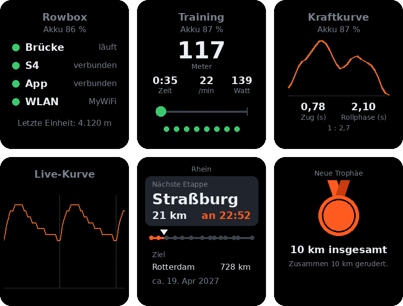
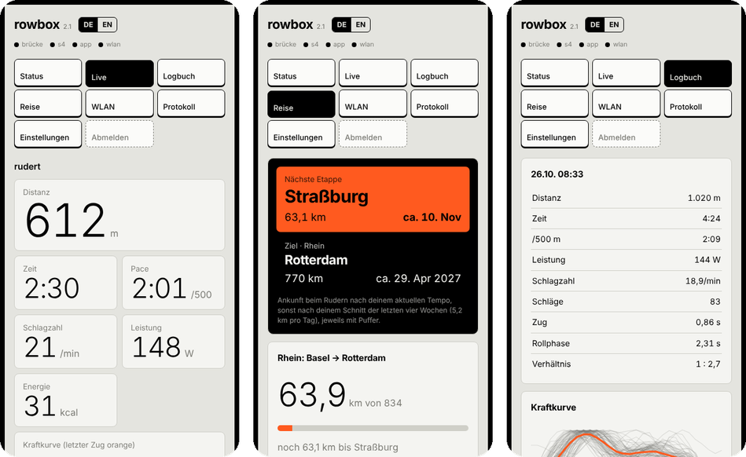
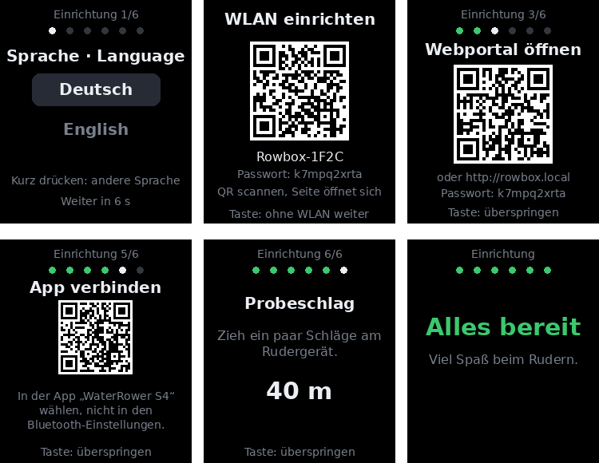

# Rowbox

**Eine kleine Box mit Akku, die dem WaterRower-S4-Monitor Bluetooth beibringt.**

Der S4-Monitor des WaterRower hat einen USB-Anschluss, aber kein Bluetooth (beim Lite und bei
älteren Original- und Metallic-Modellen). Die Rowbox wird dort angesteckt, liest den Monitor aus
und meldet sich als normales **Bluetooth-FTMS-Rudergerät**, das Fitness-Apps verstehen. So landen
die Einheiten zum Beispiel über *Rowing Workout* auf der Apple Watch in Apple Health und Fitness.

Sie läuft auf einem Raspberry Pi Zero 2 W mit PiSugar-3-Akku und PiSugar-Whisplay-Display.

[English](README.md)

<p align="center">
  
  
</p>
<p align="center"><sub>Die Box im Gehäuse und sechs ihrer Ansichten: Status, Training mit Taktgeber, Kraftkurve, Live-Kurve vom Paddelrad, Reise und eine Trophäe.</sub></p>

## Funktionen

- **Brücke S4 → Bluetooth FTMS:** Distanz, Schlagzahl, Schläge, Pace, Leistung, Kalorien, Zeit.
  Ein Reset aus der App wird an den S4 weitergegeben. Der Puls geht mit, wenn der S4 einen
  Pulsempfänger hat. Außerdem meldet die Box Hersteller, Modell und Version
  (Device-Information-Dienst), was manche Apps vor dem Verbinden verlangen.
- **Display:** Status (Brücke, S4, App, WLAN, Akku), Training live, Zusammenfassung nach der
  Einheit, Verlauf der letzten Einheiten. Geht nach einer Weile aus, die Taste weckt es.
- **Tasten:** Die Taste am Display wechselt mit kurzem Druck die Ansicht, drei Sekunden halten
  öffnet den Hotspot (oder schließt ihn). Die untere Taste am PiSugar 3 (bei den Akku-LEDs) zeigt
  mit kurzem Druck den Akkustand auf den vier LEDs und schaltet die Box mit kurz drücken und dann
  lang halten ein (die LEDs zählen hoch, dann startet sie). Läuft die Box, fährt lang halten
  sie sauber herunter, bevor der Strom ausgeht; kurz drücken und dann lang halten trennt den Strom
  sofort (nur nötig, wenn die Box hängt). Die obere PiSugar-Taste ist eine Abkürzung: kurz zeigt
  die Statusanzeige, lang wechselt die Sprache.
- **Logbuch:** Jede Einheit wird auf der Box gespeichert (Distanz, Zeit, Pace, Schnitt- und
  Spitzen-Watt, Schlagzahl, Puls). Download als CSV oder JSON, und jede Einheit als **FIT- oder
  TCX-Datei** mit Werten pro Sekunde für Strava, Garmin Connect, Intervals.icu und andere.
- **Webportal** unter `http://<hostname>.local`: Status, WLAN, Logbuch, Protokolle, Einstellungen.
  Mit Passwort.
- **Live-Ansicht** im Browser: große Zahlen für Handy oder Tablet am Ruderer, dazu die
  Kraftkurve jedes Zugs sowie Zug- und Rollphase.

  <p align="center"></p>
  <p align="center"><sub>Webportal auf dem Handy: Live-Ansicht, Reise und die Auswertung einer Einheit.</sub></p>
- **Kraftkurve:** Der S4 meldet alle 25 ms die Impulse seines Sensors am Paddelrad. Daraus
  berechnet die Box die Form jedes Zugs, ganz ohne zusätzlichen Sensor. Sie erscheint live, auf
  dem Display und pro Einheit im Logbuch (Durchschnitt, jeder einzelne Zug, Anfang und Ende der
  Einheit im Vergleich).
- **Taktgeber und Live-Kurve** auf dem Display: Ein Punkt läuft wie der Rollsitz (schnell im
  Zug, langsam zurück) im eigenen Rhythmus oder mit fester Schlagzahl; Punkte darunter zeigen, ob
  der Zug im Takt war. Die Live-Kurve zeigt das Tempo des Paddelrads der letzten sechs Sekunden.
  Beides gibt es als eigene Ansicht und als Streifen in der Trainingsansicht (in den
  Einstellungen umstell- und abschaltbar).
- **Reise und Trophäen:** Jeder geruderte Meter bringt ein Boot auf einer echten Strecke voran
  (Ärmelkanal, Rhein, Themse, Seine, Po, Nil, Jangtse, Mississippi, Amazonas, Murray, der Onyx in
  der Antarktis oder über den Atlantik), dargestellt wie eine Navigation mit nächster Etappe,
  Ziel und entspannt geschätzter Ankunft. Trophäen, etwa für die
  ersten 10 km oder eine Stunde am Stück, erscheinen nach der Einheit auf dem Display. Keine
  Serien, keine Fristen, nichts geht verloren; in den Einstellungen abschaltbar.
- **Eigene Auswahl an Ansichten:** In den Einstellungen legst du fest, welche Ansichten die
  Display-Taste durchblättert.
- **Pause mit Countdown:** In einer kurzen Pause bleibt das Display in der Trainingsansicht und
  zeigt, wann die Einheit automatisch endet.
- **MQTT (optional):** schickt die Werte an einen MQTT-Server; Home Assistant erkennt sie von
  selbst.
- **Hotspot als Rückfall:** Findet die Box kein bekanntes WLAN, öffnet sie ihr eigenes und zeigt
  einen QR-Code. Scannen, die Einrichtungsseite öffnet sich von selbst, WLAN auswählen.
- **Deutsch und Englisch:** Display, Webportal und Installationsskript. Die Sprache wird im
  Einrichtungsassistenten gewählt und lässt sich im Portal jederzeit ändern.
- **Einrichtungsassistent:** Beim ersten Start führt das Display durch Sprache, WLAN, Webportal
  (Anmeldung per QR-Code), S4 anschließen, App verbinden und einen Probeschlag. Jeder Schritt hakt
  sich selbst ab, die Taste überspringt einen Schritt.

  <p align="center"></p>
- **Uhrzeit ohne WLAN:** Die Zeit kommt aus der Echtzeituhr des PiSugar 3, damit stimmen die
  Einträge im Logbuch auch offline.
- **Töne:** kurze Klänge, wenn S4 oder App sich verbinden und wenn eine Einheit gespeichert ist
  (abschaltbar).
- **S4-Simulator**, um alles ohne Rudergerät zu testen.

## Teile

| Teil | Hinweis |
|---|---|
| Raspberry Pi Zero 2 W | mit eingelöteter Stiftleiste |
| [PiSugar 3](https://github.com/PiSugar/pisugar-power-manager-rs) | Akku mit 1.200 mAh, sitzt unter dem Pi. Optional: Eine USB-Powerbank geht auch, dann fehlen nur Akkuanzeige, Uhr und Ausschalttaste (Ausschalten dann im Webportal) |
| [PiSugar Whisplay HAT](https://github.com/PiSugar/whisplay) | 1,69"-LCD, Lautsprecher, Mikrofone, Taste, RGB-LED |
| microSD-Karte | ab 8 GB |
| USB-Kabel | Mini-USB (S4) auf Micro-USB (Pi), oder Mini-USB-Kabel plus Micro-USB-OTG-Adapter |
| Gehäuse | zum Drucken: [PiSugar suit-cases / pisugar3-whisplay-chatbot-fdm](https://github.com/PiSugar/suit-cases/tree/main/pisugar3-whisplay-chatbot-fdm) |

Der S4 kommt an den **inneren** Micro-USB-Anschluss des Zero (beschriftet mit USB), nicht an den
Stromanschluss.

<p align="center"></p>
<p align="center"><sub>Ohne Gehäuse: oben das Whisplay-Display, darunter der Pi Zero 2 W und der PiSugar 3 mit Akku.</sub></p>


## Installation

1. Mit dem Raspberry Pi Imager **Raspberry Pi OS Lite (64-bit)** schreiben. In den Einstellungen
   Hostname (zum Beispiel `rowbox`), Benutzer, Passwort, WLAN festlegen und SSH einschalten.
2. Starten, ein paar Minuten warten (der erste Start dauert auf dem Zero lange), dann anmelden:
   `ssh <benutzer>@<hostname>.local`
3. Installieren:
   ```sh
   sudo apt install -y git
   git clone https://github.com/intecsys/rowbox.git
   sudo bash rowbox/setup.sh
   sudo reboot
   ```
   Das richtet Brücke, Anzeige und Portal als Dienste ein, dazu die PiSugar-Werkzeuge, den
   Whisplay-Treiber (baut ein Kernelmodul, dauert eine Weile) und den WLAN-Fix für gemischte WPA2/WPA3-Router (siehe unten).
4. Nach dem Neustart startet der Einrichtungsassistent auf dem Display und fragt zuerst nach der
   Sprache (Taste drücken wechselt, nach ein paar Sekunden geht es von selbst weiter). Das Passwort
   fürs Portal steht außerdem unter **Info**.

   `setup.sh` spricht je nach Systemsprache Deutsch oder Englisch; festlegen lässt es sich mit
   `sudo bash rowbox/setup.sh --lang de` (oder `--lang en`).

## Benutzung

1. S4 einschalten und mit der Box verbinden.
2. In der App mit dem Rudergerät **"WaterRower S4"** verbinden. Auf dem iPhone geschieht das in
   der App, nicht in den Bluetooth-Einstellungen von iOS.
3. Rudern. Das Display springt von selbst auf die Trainingsansicht.

Getestet mit *Rowing Workout* auf iPhone und Apple Watch: Die Einheit erscheint in Apple Fitness
als "Rudern indoor", mit der Distanz vom S4 und dem Puls von der Uhr. Andere FTMS-Apps sollten
ebenfalls funktionieren, sind aber nicht getestet.

## Testen ohne Rudergerät

```sh
sudo systemctl stop rowbridge
python3 ~/s4sim.py &
sudo python3 ~/rowbridge.py ~/s4sim
```
Der Simulator rudert 60 Sekunden, pausiert 20 und beginnt von vorn. Mit `Ctrl+C`, `kill %1` und
`sudo systemctl start rowbridge` geht es zurück in den Normalbetrieb.

## Von setup.sh bereits gelöst

- **WLAN an Routern im gemischten Modus WPA2/WPA3.** Mit dem aktuellen Raspberry Pi OS verbindet
  sich der Zero 2 W nicht mit Routern im gemischten Modus WPA2/WPA3
  ([raspberrypi/linux#7634](https://github.com/raspberrypi/linux/issues/7634)). `setup.sh` behebt
  das automatisch und trägt dafür `brcmfmac.feature_disable=0x2282000` in
  `/boot/firmware/cmdline.txt` ein. Nach dem Neustart funktionieren solche Netze, zu tun ist
  nichts. Getestet mit Kernel 6.18.

## Bekannte Probleme
- **"Killed" bei der Installation:** Der Zero hat nur 512 MB Arbeitsspeicher, apt läuft manchmal
  über. `setup.sh` einfach noch einmal starten.
- **PiSugar-Download langsam:** Der Paketserver von PiSugar ist aus Europa teils langsam. Abwarten.
- **LED und Display werden absichtlich nicht gedimmt.** Die Whisplay-Bibliothek dimmt per Software,
  dann flackern beide, sobald der Prozessor rechnet.
- Der S4 bleibt eingeschaltet, solange die Box angeschlossen ist und läuft, und leert dabei seine
  Batterien. Nach dem Rudern die Box ausschalten (PiSugar-Taste halten) oder abziehen.

## Aufbau

```
S4-Monitor --USB seriell--> rowbridge.py --Bluetooth FTMS--> App
                                |
                                +--> /run/rowbridge/state.json --> rowdisplay.py (Whisplay)
                                +--> /var/lib/rowbridge/sessions.jsonl (Logbuch)
rowportal.py: Webportal auf Port 80, Hotspot als Rückfall, Einstellungen in /etc/rowbox.json
```

## Verwandte Projekte

- [PiRowFlo](https://github.com/inonoob/pirowflo): S4/SmartRow nach BLE und ANT+ auf dem Raspberry Pi
- [OpenRowingMonitor](https://github.com/JaapvanEkris/openrowingmonitor): Rudermonitor mit eigenem Sensor am Schwungrad
- [ESP Rowing Monitor](https://github.com/Abasz/ESPRowingMonitor): dasselbe auf einem ESP32

## Lizenz

GPL-3.0-or-later, siehe [LICENSE](LICENSE). Du darfst Rowbox frei nutzen, ändern und weitergeben,
auch kommerziell, solange du den vollständigen Quellcode deiner Version unter derselben Lizenz
veröffentlichst.

Ohne Gewährleistung. Nachbau und Nutzung auf eigene Gefahr, besonders beim LiPo-Akku: eine
ordentliche Zelle mit Schutzschaltung verwenden und nicht unbeaufsichtigt laden.

WaterRower ist eine Marke ihres Inhabers. Dieses Projekt steht in keiner Verbindung zu WaterRower.
