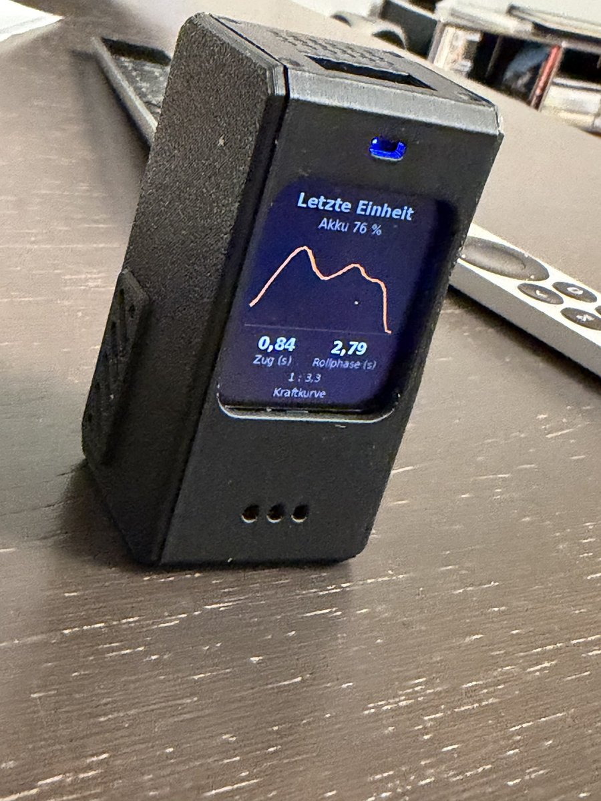
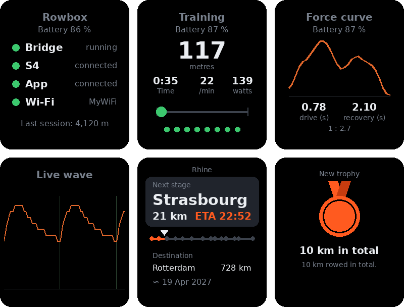
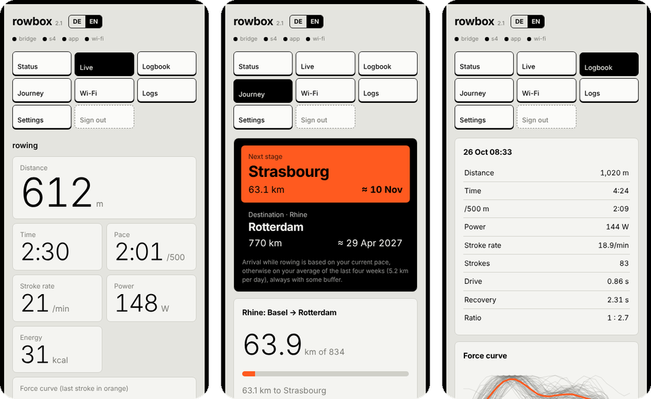
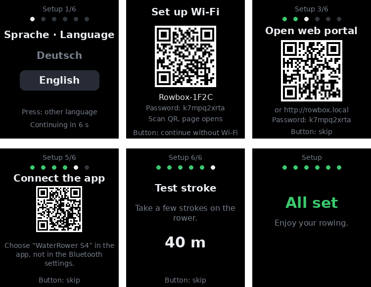
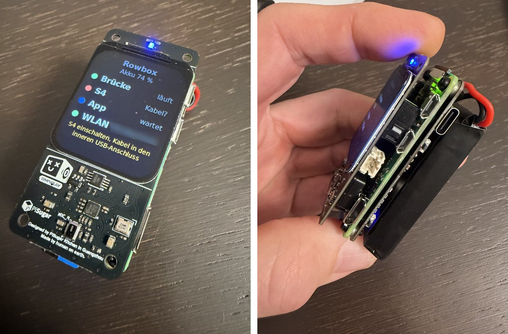

# Rowbox

**A small battery-powered box that adds Bluetooth to the WaterRower S4 monitor.**

The WaterRower S4 performance monitor has a USB port but no Bluetooth (the Lite and older
Original/Metallic models). Rowbox plugs into that USB port, reads the monitor and broadcasts a
standard **Bluetooth FTMS rower** that fitness apps understand. Your workouts end up in apps
like *Rowing Workout* on the Apple Watch and from there in Apple Health and Fitness.

It runs on a Raspberry Pi Zero 2 W with a PiSugar 3 battery and a PiSugar Whisplay display.

[Deutsche Anleitung](README.de.md)

<p align="center">
  
  
</p>
<p align="center"><sub>The box in its case, and six of its display screens: status, training with pacer, force curve, live flywheel wave, journey and a trophy.</sub></p>

## Features

- **S4 → Bluetooth FTMS bridge:** distance, stroke rate, stroke count, pace, power, calories, time.
  A reset from the app is passed on to the S4. Heart rate is passed on too if the S4 has a
  heart rate receiver. The box also reports manufacturer, model and version (Device Information
  service), which some apps need before they connect.
- **Display:** status (bridge, S4, app, Wi-Fi, battery), live training, summary after a workout,
  history of the last sessions. Turns off after a while, button wakes it.
- **Buttons:** short press on the display button cycles the screens, holding it for 3 s opens
  the hotspot (or closes it). The lower PiSugar 3 button (next to the battery LEDs) shows the
  battery level on its four LEDs with a short press, and switches the box on with a short press
  followed by a long hold (the LEDs count up, then it starts). Holding it while the box runs shuts it down
  cleanly before the power goes off; short press plus long hold cuts the power immediately (only
  if the box hangs). The upper PiSugar 3 button is a shortcut: short press shows the status
  screen, long press switches the language.
- **Logbook:** every session is saved on the box (distance, time, pace, average/max watts,
  stroke rate, heart rate). Download as CSV or JSON, and every session as a **FIT or TCX file**
  with per-second data for Strava, Garmin Connect, Intervals.icu and others.
- **Web portal** at `http://<hostname>.local`: status, Wi-Fi networks, logbook, logs, settings.
  Password protected.
- **Live view** in the browser: big numbers for a phone or tablet at the rower, plus the force
  curve of every stroke, drive and recovery time.

  <p align="center"></p>
  <p align="center"><sub>Web portal on a phone: live view, journey and the analysis of one session.</sub></p>
- **Force curve:** the S4 reports its paddle-wheel sensor pulses every 25 ms. From these the box
  computes the shape of each stroke (no extra sensor needed). It shows up live, on the display and
  per session in the logbook (average, every single stroke, start vs. end of the session).
- **Pacer and live wave** on the display: a dot moves like the seat (fast on the drive, slow on
  the recovery) in your own rhythm or at a fixed stroke rate; dots below show whether each stroke
  was in time. The live wave shows the paddle-wheel speed of the last six seconds. Both are extra
  screens and can also run as a strip in the training screen (switchable in the settings).
- **Journey and trophies:** every metre you row moves a boat along a real route (English Channel,
  Rhine, Thames, Seine, Po, Nile, Yangtze, Mississippi, Amazon, Murray, the Onyx in Antarctica or
  across the Atlantic), shown like a navigation screen with the next stage, the destination and
  relaxed arrival estimates. Trophies for things like the first
  10 km or an hour in one go appear on the display after a session. No streaks, no deadlines,
  nothing to lose; switch it off in the settings if you like.
- **Your own set of screens:** in the settings you choose which screens the display button
  cycles through.
- **Pause countdown:** during a short break the display stays on the training screen and shows
  how long until the session ends automatically.
- **MQTT (optional):** sends the values to an MQTT server; Home Assistant picks them up
  automatically.
- **Hotspot fallback:** if no known Wi-Fi is around, the box opens its own hotspot and shows a
  QR code. Scan it, the setup page opens on its own, pick your network.
- **German and English:** display, web portal and setup script. The language is chosen in the
  setup assistant and can be changed in the portal at any time.
- **Setup assistant:** on first start the display guides through language, Wi-Fi, web portal
  (login by scanning a QR code), connecting the S4, connecting the app and a test stroke. Each step
  ticks itself off; the button skips a step.

  <p align="center"></p>
- **Clock without Wi-Fi:** the time is taken from the PiSugar 3 real-time clock, so logbook
  entries are correct even offline.
- **Sounds:** short tones when the S4 or the app connects and when a session is saved (can be
  switched off).
- **S4 simulator** for testing everything without the rowing machine.

## Hardware

| Part | Notes |
|---|---|
| Raspberry Pi Zero 2 W | with soldered GPIO header |
| [PiSugar 3](https://github.com/PiSugar/pisugar-power-manager-rs) | 1200 mAh battery board, sits under the Pi. Optional: a USB power bank works too, you only lose the battery level, the clock and the power button (shut down via the web portal) |
| [PiSugar Whisplay HAT](https://github.com/PiSugar/whisplay) | 1.69" LCD, speaker, mics, button, RGB LED |
| microSD card | 8 GB or more |
| USB cable | Mini-USB (S4) to Micro-USB (Pi), or Mini-USB cable plus Micro-USB OTG adapter |
| Case | 3D-printable: [PiSugar suit-cases / pisugar3-whisplay-chatbot-fdm](https://github.com/PiSugar/suit-cases/tree/main/pisugar3-whisplay-chatbot-fdm) |

The S4 goes into the **inner** Micro-USB port of the Zero (labelled USB), not the power port.

<p align="center"></p>
<p align="center"><sub>Without the case: the Whisplay display on top, the Pi Zero 2 W and the PiSugar 3 with its battery underneath.</sub></p>


## Installation

1. Write **Raspberry Pi OS Lite (64-bit)** with Raspberry Pi Imager. In the settings set a
   hostname (e.g. `rowbox`), user, password, your Wi-Fi and enable SSH.
2. Boot, wait a few minutes (first boot is slow on the Zero), then log in:
   `ssh <user>@<hostname>.local`
3. Install:
   ```sh
   sudo apt install -y git
   git clone https://github.com/intecsys/rowbox.git
   sudo bash rowbox/setup.sh
   sudo reboot
   ```
   This installs the bridge, display and portal as services, the PiSugar tools, the Whisplay
   driver (builds a kernel module, takes a while) and the Wi-Fi fix for mixed WPA2/WPA3 routers (see below).
4. After the reboot the setup assistant starts on the display and first asks for the language
   (press the button to switch, it continues by itself after a few seconds). The portal password
   is also on the **Info** screen.

   `setup.sh` speaks German or English depending on the system language; force one with
   `sudo bash rowbox/setup.sh --lang en` (or `--lang de`).

## Usage

1. Switch on the S4 and connect it to the box.
2. In your app, connect to the rower **"WaterRower S4"**. On iPhone this happens inside the app,
   not in the iOS Bluetooth settings.
3. Row. The display switches to the training screen by itself.

Tested with *Rowing Workout* on iPhone and Apple Watch: the session appears in Apple Fitness
as "Indoor Rowing" with distance from the S4 and heart rate from the watch. Other FTMS apps
should work too but have not been tested.

## Testing without the rower

```sh
sudo systemctl stop rowbridge
python3 ~/s4sim.py &
sudo python3 ~/rowbridge.py ~/s4sim
```
The simulator rows for 60 s, pauses 20 s and repeats. `Ctrl+C`, `kill %1` and
`sudo systemctl start rowbridge` return to normal.

## Already handled by setup.sh

- **Wi-Fi with WPA2/WPA3 mixed-mode routers.** With current Raspberry Pi OS the Zero 2 W cannot
  connect to routers in mixed WPA2/WPA3 mode
  ([raspberrypi/linux#7634](https://github.com/raspberrypi/linux/issues/7634)). `setup.sh` fixes
  this automatically by adding `brcmfmac.feature_disable=0x2282000` to
  `/boot/firmware/cmdline.txt`. After the reboot these networks work; there is nothing to do.
  Tested with kernel 6.18.

## Known issues
- **"Killed" during installation:** the Zero has only 512 MB RAM and apt sometimes runs out.
  Run `setup.sh` again, it continues where it failed.
- **PiSugar download is slow:** the PiSugar package server can be slow from Europe. Just wait.
- **LED and backlight are not dimmed on purpose.** The Whisplay library dims them in software,
  which makes them flicker whenever the CPU is busy.
- The S4 stays switched on while the box is connected and running, which drains its batteries.
  Switch the box off (hold the PiSugar button) or unplug it after rowing.

## How it works

```
S4 monitor --USB serial--> rowbridge.py --Bluetooth FTMS--> app
                               |
                               +--> /run/rowbridge/state.json --> rowdisplay.py (Whisplay)
                               +--> /var/lib/rowbridge/sessions.jsonl (logbook)
rowportal.py: web portal on port 80, Wi-Fi hotspot fallback, settings in /etc/rowbox.json
```

The S4 USB protocol is documented by WaterRower ("Water Rower S4 S5 USB Protocol Iss 1 04")
and in several open source projects.

## Related projects

- [PiRowFlo](https://github.com/inonoob/pirowflo): S4/SmartRow to BLE and ANT+ on a Raspberry Pi
- [OpenRowingMonitor](https://github.com/JaapvanEkris/openrowingmonitor): rowing monitor with its own flywheel sensor
- [ESP Rowing Monitor](https://github.com/Abasz/ESPRowingMonitor): the same on an ESP32

## License

GPL-3.0-or-later, see [LICENSE](LICENSE). You may use, change and share Rowbox freely, also
commercially, as long as you publish the full source of your version under the same license.

No warranty. You build and use the box at your own risk, especially the LiPo battery: use a proper
cell with protection circuit and don't leave it charging unattended.

WaterRower is a trademark of its owner. This project is not affiliated with or endorsed by
WaterRower.
