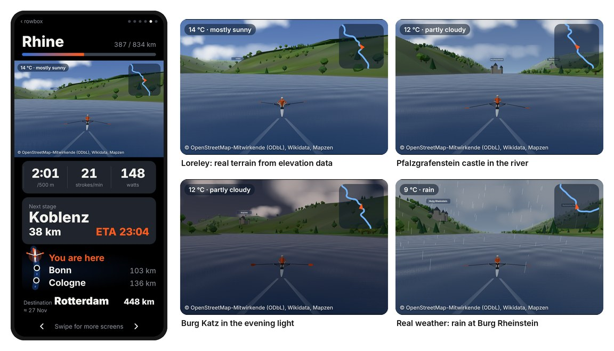
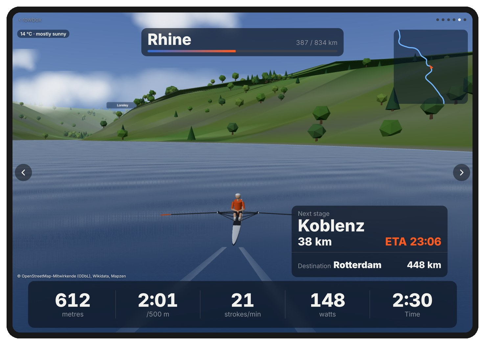
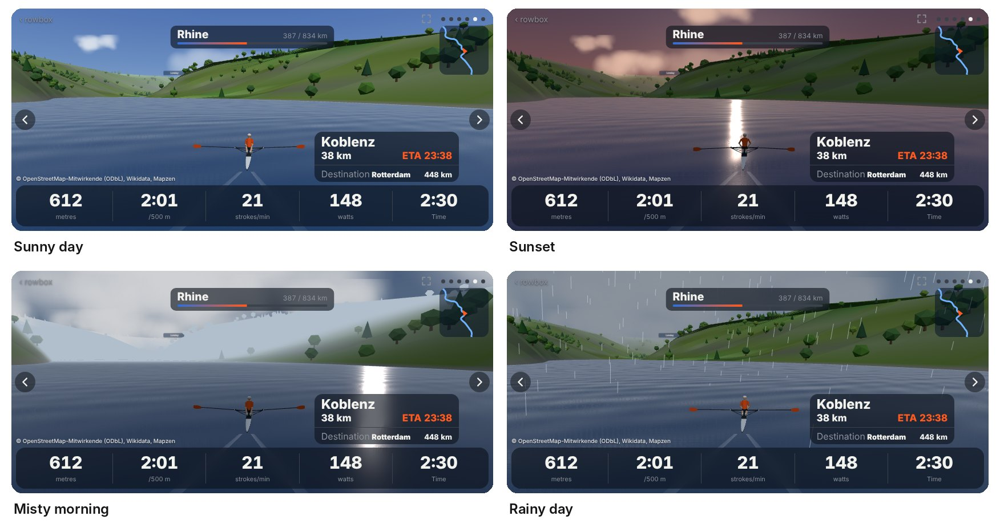

# Rowbox

**Bluetooth for the WaterRower S4. A small open-source box with display, force curve, logbook and
a 3D river journey on your phone.**

[](LICENSE)


[Deutsche Anleitung](README.de.md)

The WaterRower S4 performance monitor has a USB port but no Bluetooth. Rowbox plugs into that
port, reads the monitor and broadcasts a standard **Bluetooth FTMS rower** that fitness apps
understand, so your sessions end up in apps like *Rowing Workout* on the Apple Watch and from there
in Apple Health. On top it shows your training on its own display or on your phone, records every
stroke and lets you row real rivers.

<p align="center">
  
  
</p>
<p align="center"><sub>The box in its case, and six of its display screens: status, training with pacer, force curve, live flywheel wave, journey and a trophy.</sub></p>

## At a glance

| | |
|---|---|
| **Connects** | WaterRower S4 (USB) → Bluetooth FTMS rower for iPhone, Apple Watch, Android, Meta Quest and more |
| **Shows** | Live values, force curve, pacer and journey on the box display, in the browser and full-screen on a phone or tablet |
| **Records** | Every session in a logbook with per-second data, export as FIT, TCX, CSV or JSON for Strava, Garmin Connect, Intervals.icu |
| **Motivates** | Journeys along real routes, a 3D Rhine from Basel to Rotterdam with real terrain, landmarks and weather, relaxed trophies |
| **Runs** | On a Raspberry Pi Zero 2 W, with or without battery and display, entirely offline if you like |
| **Costs** | About 35–100 € in parts, depending on the [version](#versions) |

## Contents

- [Features](#features)
- [Row the Rhine in 3D](#row-the-rhine-in-3d)
- [Hardware](#hardware)
- [Installation](#installation)
- [Usage](#usage)
- [Compatibility](#compatibility)
- [Troubleshooting](#troubleshooting)
- [Privacy](#privacy)
- [Development](#development)
- [License and credits](#license-and-credits)

## Features

### Bluetooth bridge

- **Standard FTMS rower:** distance, stroke rate, stroke count, pace, power, calories and time.
  Apps see a rower called **"WaterRower S4"**.
- **Two-way:** a reset from the app resets the S4. Heart rate is passed on if the S4 has a heart
  rate receiver.
- **Well-behaved:** the box reports manufacturer, model and version (Device Information service),
  which some apps need before they connect. It reads the S4's firmware version and shows it in
  the portal.

### On the box

- **Display:** status, live training, summary after a session, history of the last sessions,
  pacer, live wave and journey. Turns off after a while, a button wakes it. You choose which
  screens the button cycles through.
- **Setup assistant:** on first start the display guides through language, Wi-Fi, web portal
  (login by QR code), connecting the S4 and the app and a test stroke. Each step ticks itself off.
- **Buttons:** a short press on the display button cycles the screens, holding it for 3 s opens the
  hotspot. The PiSugar button shows the battery level, switches the box on and shuts it down
  cleanly ([details](#buttons)).
- **Pause countdown, sounds, clock without Wi-Fi:** during a short break the display shows when the
  session ends automatically; short tones when the S4 or the app connects; the PiSugar real-time
  clock keeps logbook times right even offline.

<p align="center"></p>

### Web portal

At `http://<hostname>.local`, password protected: status, Wi-Fi networks, logbook, logs and all
settings. The **live view** shows big numbers for a phone or tablet at the rower, the force curve of
every stroke and drive and recovery times.

<p align="center"></p>
<p align="center"><sub>Web portal on a phone: live view, journey and the analysis of one session.</sub></p>

### Phone and tablet as display

`http://<hostname>.local/display` shows the box's screens full-screen on your phone: training,
force curve, pacer, live wave, journey and status, switched by swiping. With the Ultralight version
this is your display.

- **Portrait and landscape:** every screen has its own layout for both. Sideways, the journey
  becomes a cockpit with the 3D river across the whole screen.
- **Stays on:** the screen does not lock while the display is open.
- **Like an app:** a full-screen button on iPad and Android; on the iPhone add the page to the home
  screen and it opens without browser bars.

<p align="center"></p>

### Force curve, pacer and live wave

- **Force curve:** the S4 reports its paddle-wheel sensor pulses every 25 ms. From these the box
  computes the shape of each stroke, no extra sensor needed. Live, on the display and per session
  in the logbook (average, every single stroke, start vs. end).
- **Pacer:** a dot moves like the seat, fast on the drive, slow on the recovery, in your own rhythm
  or at a fixed rate. Dots below show whether each stroke was in time.
- **Live wave:** the paddle-wheel speed of the last six seconds.

### Logbook and export

Every session is saved on the box: distance, time, pace, average and maximum watts, stroke rate,
heart rate and the force curve. Download the logbook as CSV or JSON and every session as a
**FIT or TCX file** with per-second data for Strava, Garmin Connect, Intervals.icu and others.

### Journeys and trophies

Every metre moves a boat along a real route: the Rhine, Thames, Seine, Po, Nile, Yangtze,
Mississippi, Amazon, Murray, the English Channel, the Onyx in Antarctica or across the Atlantic.
Shown like a sat-nav with the next stage, the destination and relaxed arrival estimates. Trophies
for things like the first 10 km appear after a session. No streaks, no deadlines, nothing to lose;
switch it off if you like. On the Rhine the journey is a [3D scene](#row-the-rhine-in-3d).

### Connectivity

- **Hotspot fallback:** if no known Wi-Fi is around, the box opens its own hotspot and shows a QR
  code; the setup page opens by itself. A printable **hotspot card** keeps name, password and QR
  code at hand.
- **MQTT (optional):** sends the values to an MQTT server; Home Assistant picks them up
  automatically.
- **German and English:** display, web portal and setup script, switchable at any time.

## Row the Rhine in 3D

On your phone the journey screen shows a single scull on the river, and the rower in it moves with
**your** strokes: each drive starts with your real catch, legs first, then the body, and the boat
surges with the shape of your force curve. Stop rowing and he waits at the catch.

<p align="center"></p>

- **The real Rhine, Basel to Rotterdam (834 km):** the course of the river from OpenStreetMap,
  real terrain from elevation data (the Middle Rhine valley rises 150–200 m on both banks), 74
  bridges and 242 landmarks by name, from Burg Rheinstein and the Loreley to the windmills of
  Kinderdijk. A small map shows where you are.
- **Real light and weather:** the sun stands where it really stands at that place and time. When
  the box is online it adds the current weather at your virtual position: clouds, rain, snow, fog
  and wind on the water. Or pick a fixed mood: sunny day, sunset, misty morning or rainy day.
- **Live values on the river:** pace, stroke rate and watts in a card under the scene, together
  with the next stage and the destination.
- **Cockpit in landscape:** on a tablet or a phone turned sideways the river fills the screen,
  with the route, the next stage and five live values on glass panels.
- **Yours to set up:** choose which parts the screen shows and the colours of the boat, the blades
  and the rower's shirt (Settings → Journey).
- **Light on the box:** three.js runs in the phone's browser and adapts its resolution to the
  device; the Pi only serves the files. The route ships with the box, no map service needed while
  you row.

<p align="center"></p>
<p align="center"><sub>Sideways on a tablet: the journey as a cockpit.</sub></p>

<p align="center"></p>
<p align="center"><sub>Fixed moods for when you prefer the light of your choice to the real one.</sub></p>

Other routes use a generated river for now; `tools/build_route.py` turns OpenStreetMap data into a
route file (see [CONTRIBUTING](CONTRIBUTING.md)).

## Hardware

### Versions

| | Full | Light | Ultralight |
|---|---|---|---|
| Raspberry Pi Zero 2 W | ✓ | ✓ | ✓ |
| PiSugar Whisplay (display) | ✓ | ✓ | – |
| PiSugar 3 (battery) | ✓ | – (USB power bank or power supply) | – (USB power bank or power supply) |
| Bluetooth FTMS, force curve, logbook, FIT/TCX, journeys, web portal, MQTT | ✓ | ✓ | ✓ |
| Phone and tablet as display, 3D river | ✓ | ✓ | ✓ |
| Display on the box, sounds, setup assistant | ✓ | ✓ | – |
| Battery level, power button, clock without Wi-Fi | ✓ | – | – |
| Parts cost (approx.) | 100 € | 70 € | 35 € |
| Install | `setup.sh` | `setup.sh --no-pisugar` | `setup.sh --no-display --no-pisugar` |

Light and Ultralight are new and not yet tested on a real box; feedback welcome. Without the
PiSugar, shut the box down in the web portal before unplugging it.

### Parts

| Part | Notes |
|---|---|
| Raspberry Pi Zero 2 W | with soldered GPIO header |
| [PiSugar 3](https://pisugar.com) | 1200 mAh battery board, sits under the Pi ([software](https://github.com/PiSugar/pisugar-power-manager-rs)). Optional: a USB power bank works too, you only lose the battery level, the clock and the power button |
| [PiSugar Whisplay HAT](https://pisugar.com) | 1.69" LCD, speaker, mics, button, RGB LED ([driver](https://github.com/PiSugar/whisplay)) |
| microSD card | 8 GB or more |
| USB cable | Mini-USB (S4) to Micro-USB (Pi), or Mini-USB cable plus Micro-USB OTG adapter |
| Case | 3D-printable: [PiSugar suit-cases / pisugar3-whisplay-chatbot-fdm](https://github.com/PiSugar/suit-cases/tree/main/pisugar3-whisplay-chatbot-fdm) |

The S4 goes into the **inner** Micro-USB port of the Zero (labelled USB), not the power port.

<p align="center"></p>
<p align="center"><sub>Without the case: the Whisplay display on top, the Pi Zero 2 W and the PiSugar 3 with its battery underneath.</sub></p>

## Installation

1. Write **Raspberry Pi OS Lite (64-bit)** with Raspberry Pi Imager. In the settings set a
   hostname (e.g. `rowbox`), user, password and your Wi-Fi, and enable SSH.
2. Boot, wait a few minutes (the first boot is slow on the Zero), then log in:
   `ssh <user>@<hostname>.local`
3. Install:
   ```sh
   sudo apt install -y git
   git clone https://github.com/intecsys/rowbox.git
   sudo bash rowbox/setup.sh
   sudo reboot
   ```
   This installs the bridge, display and portal as services, the PiSugar tools, the Whisplay
   driver (builds a kernel module, takes a while) and the Wi-Fi fix for mixed WPA2/WPA3 routers.
4. After the reboot the setup assistant starts on the display. The portal password is also on the
   **Info** screen.

`setup.sh` speaks German or English depending on the system language; force one with
`--lang en` or `--lang de`.

**Update** later with:
```sh
cd ~/rowbox && git pull && sudo bash setup.sh && sudo reboot
```

### Light and Ultralight

Step 3 with one or two options (see [Versions](#versions)):

```sh
sudo bash rowbox/setup.sh --no-pisugar                # Light: display, no battery
sudo bash rowbox/setup.sh --no-display --no-pisugar   # Ultralight: no display, no battery
```

Ultralight has no setup assistant: `setup.sh` prints the portal password, the hotspot name and a
QR code at the end (look the password up later with `sudo grep password /etc/rowbox.json`). Then
connect your app to **"WaterRower S4"**, open `http://<hostname>.local/display` on your phone and
put it on the rower.

**New Wi-Fi without a display:** if the box finds no known Wi-Fi, it opens its own hotspot after
about a minute (two minutes after power-on). Join it with the name and password from `setup.sh` or
the QR code, the setup page opens by itself (otherwise `http://10.42.0.1`), and pick your network
under **Wi-Fi**. Tip: print the **hotspot card** (portal → Settings → Hotspot) and stick it on the
box.

## Usage

1. Switch on the S4 and connect it to the box.
2. In your app, connect to the rower **"WaterRower S4"**. On the iPhone this happens inside the
   app, not in the iOS Bluetooth settings.
3. Row. The display switches to the training screen by itself.

Tested with *Rowing Workout* on iPhone and Apple Watch: the session appears in Apple Fitness as
"Indoor Rowing" with the distance from the S4 and heart rate from the watch.

### Buttons

| Button | Short press | Hold |
|---|---|---|
| Display button | next screen | 3 s: open or close the hotspot |
| PiSugar 3, lower (next to the LEDs) | show battery level; short press then hold switches the box on | while running: shut down cleanly; short press plus hold cuts the power (only if the box hangs) |
| PiSugar 3, upper | status screen | switch the language |

## Compatibility

### Apps

Rowbox shows up as a standard Bluetooth FTMS rower named **"WaterRower S4"**. "Should work" means
the vendor supports FTMS rowers in general; it has not been tested with Rowbox yet. Reports are
welcome.

| App | Platform | With Rowbox | Notes |
|---|---|---|---|
| [Rowing Workout](https://apps.apple.com/app/id6470894043) | iPhone, Apple Watch | **tested** | Free (Pro optional); saves to Apple Health/Fitness |
| [Kinomap](https://support.kinomap.com/hc/en-us/articles/360015335632-What-is-the-FTMS-protocol) | iOS, Android | should work | Subscription; supports FTMS equipment in general |
| [EXR](https://exrgame.com/support/compatible-machines) | iOS | should work | Subscription; "all FTMS rowers are compatible", accuracy not guaranteed |
| [Holofit](https://www.holodia.com/?p=5719) | Meta Quest | should work | VR, subscription; FTMS rowers connect directly |
| [Peloton App](https://www.pelobuddy.com/third-party-rowers-ftms/) | iOS | should work | App+ / All-Access; per community reports |
| [Track My Indoor Workout](https://trackmyindoorworkout.github.io) | Android | should work | Free, open source; Strava/TrainingPeaks upload, own HR strap |
| [FTMS Rowing](https://abscreations.gumroad.com/l/FTMSRowing) | Garmin (Connect IQ) | should work | Data field for "Row Indoor"; paid after 10 min |
| ArduRower-IQ | Garmin (Connect IQ) | unclear | Free; reported to work with FTMS rowers |
| MyHomeFit, WaterRower Connect, Amazfit watches | various | unclear | No clear statement for generic FTMS rowers yet |

Not compatible: ErgData, Aviron, Ergatta, Hydrow (Concept2 or own hardware only), Zwift (no
rowing), Apple GymKit (certified gym equipment only), Strava and Garmin watches directly (no
Bluetooth rowers; Garmin pairs rowers only via ANT+). For Strava and Garmin Connect use the FIT
export or an app that uploads.

### Rowing machines

| Monitor | With Rowbox | Notes |
|---|---|---|
| S4 with Mini-USB port ("S4 version 2") | **yes** | Standard on Original/Natural/Oak/Club/Shadow/M1/S1 and others; also as retrofit on Hybrid/Pure |
| S4 with RS-232 port ("S4 version 1") | unclear | Serial instead of USB; may work with a USB-serial adapter, untested |
| S4 BLE (built-in Bluetooth) | unclear | Already connects to apps itself; unknown whether it still has the USB data port |
| S4 + ComModule | either/or | The ComModule uses the same USB port; use one or the other |
| A1 / A1 BLE, Performance Ergometer | no / unclear | Different monitor, not the S4 protocol |
| Series I–III, S3 | no | Unless upgraded to an S4 |

**Which S4 do you have?** Switch it on, press **advanced** nine times, then **OK**: the firmware is
shown bottom right. USB monitors run 2.01, 2.03 or the current 2.1; WaterRower updates older ones
on request. Rowbox also shows the version in the portal. The Mini-USB port sits on the back of the
S4; while Rowbox is connected the S4 shows "PC". Details: [docs/s4-notes.md](docs/s4-notes.md).

## Troubleshooting

- **"Killed" during installation:** the Zero has only 512 MB RAM and apt sometimes runs out. Run
  `setup.sh` again, it continues where it stopped.
- **PiSugar download is slow:** the PiSugar package server can be slow from Europe. Just wait.
- **Wi-Fi with WPA2/WPA3 mixed-mode routers:** with current Raspberry Pi OS the Zero 2 W cannot
  connect to them ([raspberrypi/linux#7634](https://github.com/raspberrypi/linux/issues/7634)).
  `setup.sh` fixes this by adding `brcmfmac.feature_disable=0x2282000` to
  `/boot/firmware/cmdline.txt`; nothing to do. Tested with kernel 6.18.
- **The box is reachable under a different name:** use the hostname you set in Raspberry Pi
  Imager, e.g. `http://rower.local`.
- **LED and backlight are not dimmed on purpose:** the Whisplay library dims them in software,
  which makes them flicker whenever the CPU is busy.
- **The S4 stays on while the box is connected,** which drains its batteries. Switch the box off
  (hold the PiSugar button) or unplug it after rowing.

## Privacy

Rowbox needs no account and no cloud. Your sessions stay on the box until you export them. The only
request to the internet is optional: in the "real weather" mode the box fetches the current weather
from [Open-Meteo](https://open-meteo.com) for your *virtual* position on the route, about every
15 minutes, and only when it is online. Choose a fixed mood or "real time, no weather" in
Settings → Journey to switch it off.

## Development

### How it works

```
S4 monitor --USB serial--> rowbridge.py --Bluetooth FTMS--> app
                               |
                               +--> /run/rowbridge/state.json --> rowdisplay.py (Whisplay)
                               +--> /var/lib/rowbridge/sessions.jsonl (logbook)
rowportal.py: web portal on port 80, phone display, Wi-Fi hotspot fallback, settings in /etc/rowbox.json
static/river3d.js: 3D river (three.js) that runs in the phone's browser
```

The S4 USB protocol is documented by WaterRower ("Water Rower S4 S5 USB Protocol Iss 1 04") and in
several open-source projects. More on the S4: [docs/s4-notes.md](docs/s4-notes.md).

### Testing without the rower

```sh
sudo systemctl stop rowbridge
python3 ~/s4sim.py &
sudo python3 ~/rowbridge.py ~/s4sim
```
The simulator rows for 60 s, pauses 20 s and repeats. `Ctrl+C`, `kill %1` and
`sudo systemctl start rowbridge` return to normal.

### Contributing

Issues, ideas and pull requests are welcome, see [CONTRIBUTING.md](CONTRIBUTING.md). It also
explains how to add a journey and a real river course.

### Related projects

- [PiRowFlo](https://github.com/inonoob/pirowflo): S4/SmartRow to BLE and ANT+ on a Raspberry Pi
- [OpenRowingMonitor](https://github.com/JaapvanEkris/openrowingmonitor): rowing monitor with its own flywheel sensor
- [ESP Rowing Monitor](https://github.com/Abasz/ESPRowingMonitor): the same on an ESP32

## License and credits

Rowbox is licensed under **GPL-3.0-or-later**, see [LICENSE](LICENSE). You may use, change and
share it, also commercially, as long as you publish the full source of your version under the same
license.

| Part | Source and license |
|---|---|
| `static/three.module.min.js` | [three.js](https://threejs.org), MIT ([static/LICENSE.three.txt](static/LICENSE.three.txt)) |
| River routes in `static/routes/` | Derived from [OpenStreetMap](https://www.openstreetmap.org/copyright), © OpenStreetMap contributors, [ODbL 1.0](https://opendatacommons.org/licenses/odbl/) |
| Bridge names | [Wikidata](https://www.wikidata.org), CC0 |
| Terrain heights | [AWS Terrain Tiles](https://registry.opendata.aws/terrain-tiles/) (Mapzen/Tilezen), open data with attribution |
| Weather | [Open-Meteo](https://open-meteo.com), free for non-commercial use |

No warranty. You build and use the box at your own risk, especially the LiPo battery: use a proper
cell with protection circuit and don't leave it charging unattended.

WaterRower is a trademark of its owner. This project is not affiliated with or endorsed by
WaterRower.
